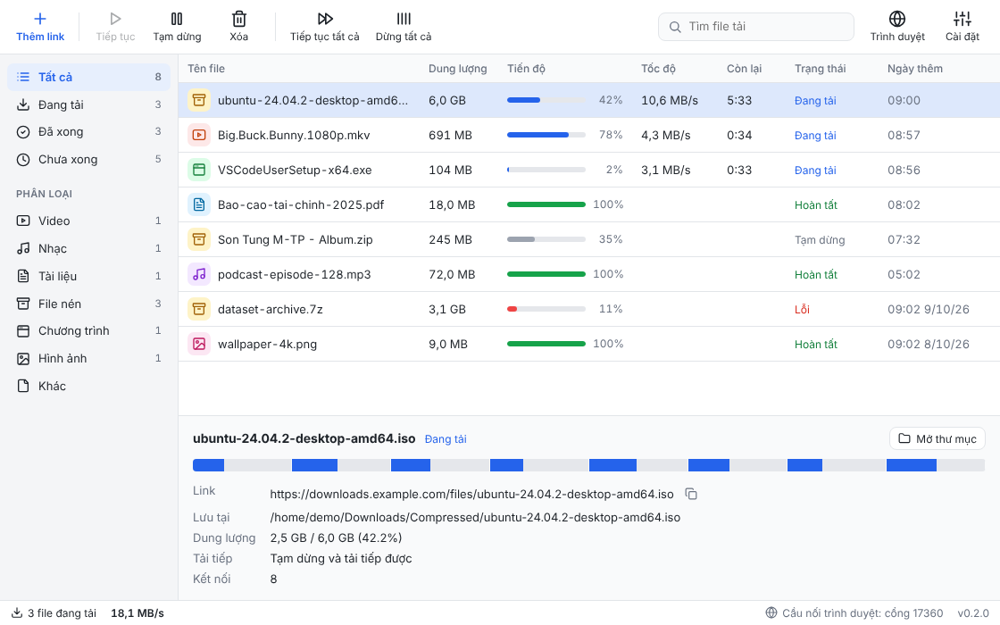
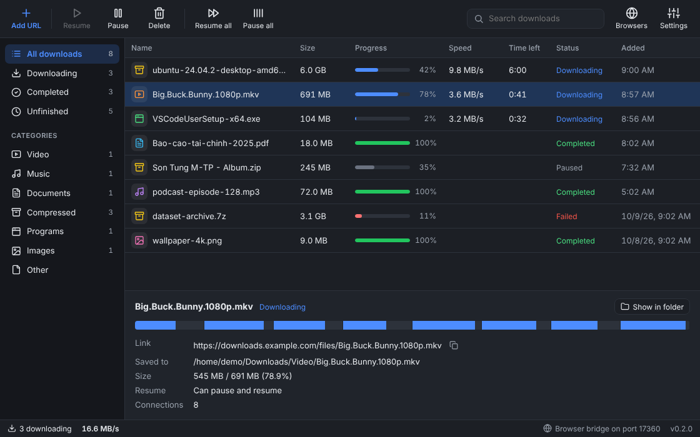
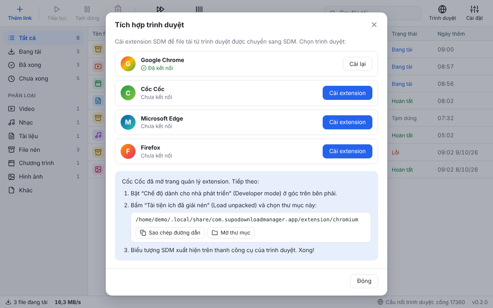

# Supo Download Manager (SDM)

**A free and open-source download accelerator for Windows, macOS and Linux.**

SDM splits a file into segments and downloads them over several connections
at the same time. When a connection finishes its part, it takes over half of
the largest part that is still left, so every connection stays busy until the
very end. Downloads survive network errors and can be paused and resumed, even
after closing the program or restarting the computer.

> 🇻🇳 [Đọc bằng tiếng Việt](#tiếng-việt)



## What's included

- **Desktop app** with a download list, categories, a download queue, a speed
  limiter, a tray icon and notifications, in English and Vietnamese, with
  light and dark themes.
- **Browser extension** for Chrome, Edge, Cốc Cốc, Brave, Opera, Vivaldi and
  Firefox. It hands downloads over to SDM, together with the cookies they need.
- **`sdm` command line tool** for scripts and servers.

> **Status: early development (v0.2).** Everything above works and is tested,
> but expect rough edges. See the [roadmap](docs/ROADMAP.md).

## Features

- **Multi-connection downloads**: up to 32 connections per file, with
  dynamic segment splitting.
- **Pause and resume**: progress is saved continuously. Quitting the app
  pauses all downloads and they continue where they stopped. Before resuming,
  SDM checks the file's size, `ETag` and `Last-Modified` date with the server,
  so if the file changed, it starts over instead of mixing old and new data.
- **Browser integration**: downloads of the file types you choose open in SDM
  instead of the browser, with cookies, referer and user agent, so downloads
  that need a login work. Right-click any link, image or video and choose
  "Download link with SDM".
- **One-click extension setup**: SDM finds the browsers on your computer and
  opens the right page to install the extension.
- **Clipboard monitoring**: copy a download link and SDM offers to download it.
- **Categories**: files are sorted into Video, Music, Documents, Compressed,
  Programs and Images, each with its own folder if you like.
- **Queue**: choose how many files download at the same time; the rest wait.
- **Robust**: automatic retries with exponential backoff. A connection that
  keeps failing hands its work to the others, which helps with servers that
  limit connections per user.
- **Works with any server**: if the server does not support resuming, SDM
  uses a single connection. It also handles files whose size is unknown.
- **Speed limit**, **proxy** (HTTP, HTTPS, SOCKS5), **safe file names**,
  **SHA-256 verification** (command line).



## Install

Installers for Windows (`.msi`, `.exe`), macOS (`.dmg`) and Linux (`.deb`,
`.rpm`, `.AppImage`) are published on the
[Releases](https://github.com/10s3r2604/supodownloadmanager/releases) page
from the first tagged version.

### Browser extension

Open SDM, click **Browsers**, pick your browser and click **Install
extension**. SDM opens the browser's extension page and shows what to do.
Details are in [docs/BROWSER_EXTENSION.md](docs/BROWSER_EXTENSION.md).



### Command line tool

```sh
cargo install --git https://github.com/10s3r2604/supodownloadmanager sdm-cli
```

```sh
sdm get https://example.com/big.iso                 # download with 8 connections
sdm get -c 16 -d ~/Downloads https://example.com/big.iso
sdm get -l 2M https://example.com/big.iso           # limit to 2 MB/s
sdm get -j 4 -i urls.txt                            # a list of links, 4 at a time
sdm get --cookie "session=abc" https://example.com/file.zip
sdm info https://example.com/big.iso                # ask the server about a file
```

Press `Ctrl+C` to pause and run the same command again to resume.

## How it works

1. **Probe**: SDM asks the server for the first byte of the file
   (`Range: bytes=0-0`). The answer reveals the size, whether byte ranges
   (and therefore multiple connections and resuming) work, and the file name.
2. **Plan**: the file is divided into equal segments, one per connection.
3. **Download**: each connection fills its segment from front to back. When a
   connection finishes early, it splits the segment with the most bytes left
   and takes over the back half.
4. **Save progress**: data goes into `name.sdm-part`, and progress is saved to
   `name.sdm-state` every two seconds and whenever the download is paused.
5. **Finish**: the part file is renamed to the final name.

The browser extension talks to the app through a small server on
`127.0.0.1` that only accepts requests from browser extensions.

## Project layout

| Path                     | What it is                                                      |
| ------------------------ | --------------------------------------------------------------- |
| `crates/sdm-core`        | The download engine (Rust library), shared by all front-ends    |
| `crates/sdm-cli`         | The `sdm` command line tool                                      |
| `apps/desktop`           | The desktop app: Tauri (Rust) backend and React interface        |
| `extension`              | The browser extension (Chromium and Firefox builds)              |
| `docs`                   | Roadmap and guides                                               |

## Building from source

You need [Rust](https://rustup.rs) and [Node.js](https://nodejs.org) 20 or
newer. On Linux, also install the WebKitGTK libraries listed in
[CONTRIBUTING.md](CONTRIBUTING.md).

```sh
cd apps/desktop
npm install
npm run tauri dev      # run the app
npm run tauri build    # build an installer
```

## Contributing

Contributions of every size are welcome: bug reports, ideas, translations,
documentation and code. See [CONTRIBUTING.md](CONTRIBUTING.md).

## License

SDM is free software under the [GNU General Public License v3.0 or later](LICENSE).
You may use, study, share and modify it. If you distribute a modified version,
it must remain free under the same license.

SDM is an independent project and is not affiliated with Internet Download
Manager or Tonec Inc.

---

## Tiếng Việt

**Supo Download Manager (SDM)** là trình tăng tốc tải xuống miễn phí, mã nguồn
mở, chạy trên Windows, macOS và Linux.

SDM chia file thành nhiều đoạn và tải cùng lúc qua nhiều kết nối. Khi một kết
nối tải xong phần của mình, nó lấy một nửa của đoạn còn lại lớn nhất để tải
tiếp, nhờ vậy mọi kết nối đều bận đến tận cuối. Mất mạng thì tự kết nối lại, tạm
dừng rồi tải tiếp được, kể cả sau khi tắt máy.

### Gồm những gì

- **Ứng dụng desktop**: danh sách tải, phân loại file, hàng đợi, giới hạn tốc
  độ, biểu tượng ở khay hệ thống, thông báo khi tải xong. Có tiếng Việt và
  tiếng Anh, giao diện sáng và tối.
- **Extension trình duyệt** cho Chrome, Edge, Cốc Cốc, Brave, Opera, Vivaldi và
  Firefox: chuyển file tải từ trình duyệt sang SDM, kèm cookie để tải được cả
  các link cần đăng nhập.
- **Công cụ dòng lệnh `sdm`** cho script và máy chủ.

### Tính năng chính

- **Tải đa luồng**: tối đa 32 kết nối mỗi file, tự chia lại đoạn khi đang tải.
- **Tạm dừng / tải tiếp**: tiến độ được lưu liên tục; tắt ứng dụng thì mọi file
  được tạm dừng và lần sau tải tiếp. Nếu file trên server đã đổi, SDM tải lại từ
  đầu chứ không ghép lẫn dữ liệu.
- **Bắt link từ trình duyệt**: các loại file bạn chọn sẽ được SDM tải thay
  trình duyệt. Chuột phải vào link, ảnh hay video và chọn "Tải link bằng SDM".
- **Cài extension bằng một nút bấm**: SDM tự tìm các trình duyệt trên máy và mở
  đúng trang để cài.
- **Theo dõi clipboard**: copy một link tải là SDM gợi ý tải ngay.
- **Phân loại**: Video, Nhạc, Tài liệu, File nén, Chương trình, Hình ảnh, mỗi
  loại một thư mục.
- **Hàng đợi**: chọn số file tải cùng lúc, các file khác chờ đến lượt.
- **Giới hạn tốc độ, proxy (HTTP, HTTPS, SOCKS5), đặt tên file an toàn.**

### Cài đặt

- **Ứng dụng**: tải bộ cài cho Windows, macOS, Linux ở trang
  [Releases](https://github.com/10s3r2604/supodownloadmanager/releases).
- **Extension**: mở SDM, bấm **Trình duyệt**, chọn trình duyệt rồi bấm **Cài
  extension**, sau đó làm theo hướng dẫn hiện ra. Chi tiết xem
  [docs/BROWSER_EXTENSION.md](docs/BROWSER_EXTENSION.md).
- **Dòng lệnh**: `cargo install --git https://github.com/10s3r2604/supodownloadmanager sdm-cli`

### Đóng góp

Mọi đóng góp đều được chào đón: báo lỗi, góp ý, dịch thuật, viết tài liệu, viết
code. Bạn có thể viết issue bằng tiếng Việt. Xem [CONTRIBUTING.md](CONTRIBUTING.md).

### Giấy phép

SDM là phần mềm tự do theo giấy phép [GNU GPL v3.0 trở lên](LICENSE). Bạn được tự
do sử dụng, chia sẻ và sửa đổi. Nếu phát hành bản sửa đổi, bản đó cũng phải là mã
nguồn mở theo cùng giấy phép.

SDM là dự án độc lập, không liên quan đến Internet Download Manager hay Tonec Inc.
