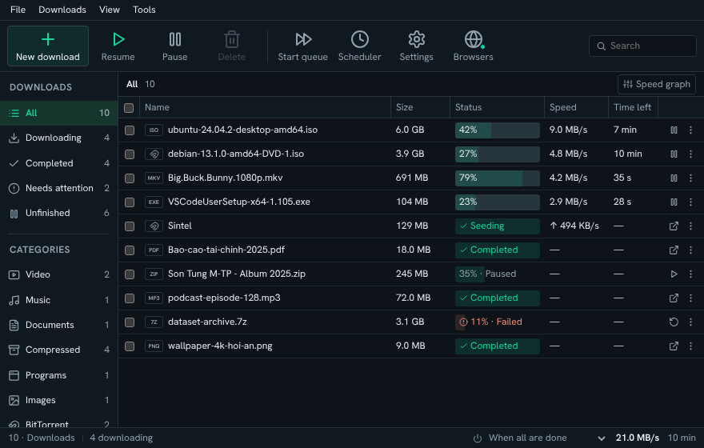
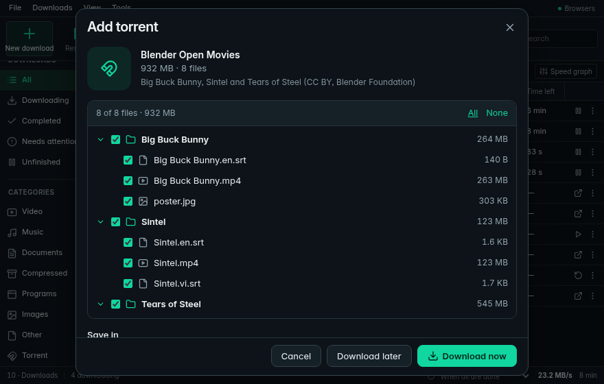
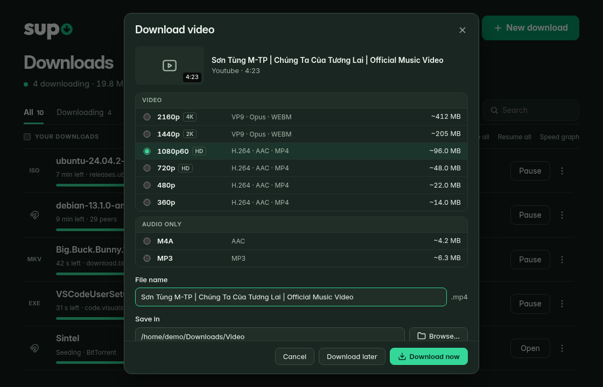
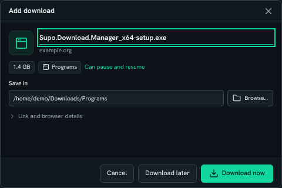
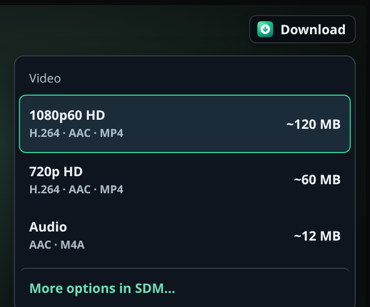
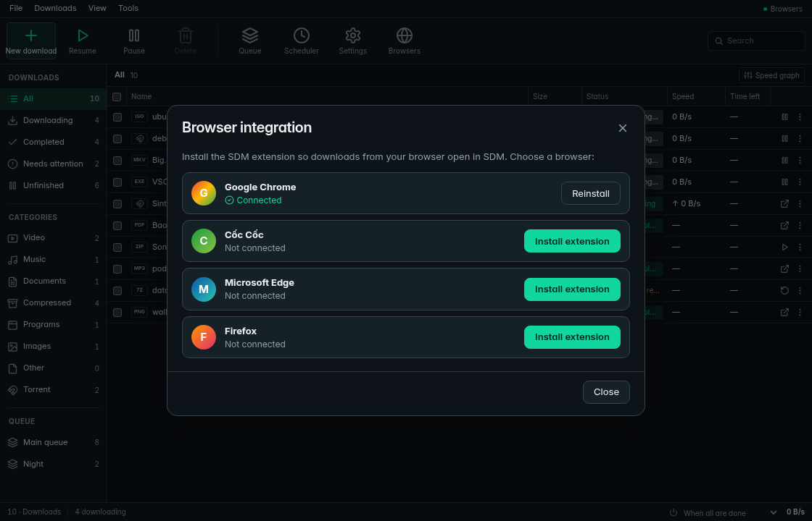
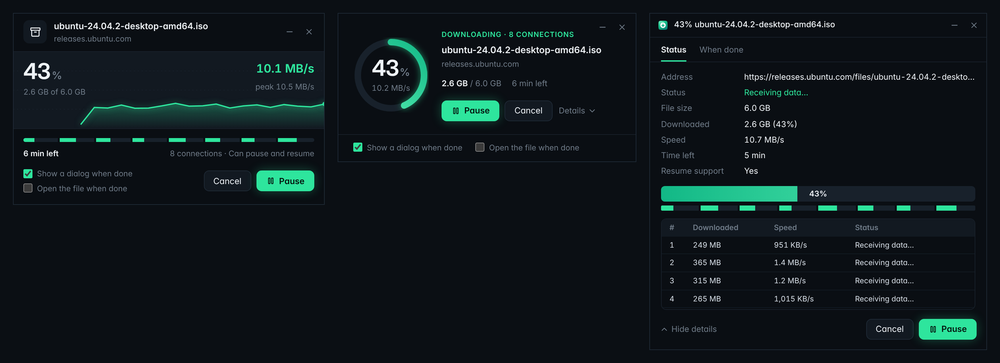

<p align="center"></p>

<h1 align="center">Supo Download Manager</h1>

<p align="center">
  <b>A free, open-source download manager for Windows, macOS and Linux.</b><br>
  Multi-connection downloads · video grabber · torrents and magnet links · browser integration
</p>

<p align="center">
  <a href="https://github.com/10s3r2604/supodownloadmanager/releases/latest"></a>
  <a href="https://github.com/10s3r2604/supodownloadmanager/actions/workflows/ci.yml"></a>
  <a href="LICENSE"></a>
  
  
</p>

<p align="center">
  <a href="https://github.com/10s3r2604/supodownloadmanager/releases/latest"><b>Download</b></a> ·
  <a href="#features">Features</a> ·
  <a href="#screenshots">Screenshots</a> ·
  <a href="#install">Install</a> ·
  <a href="#building-from-source">Build</a> ·
  <a href="docs/ROADMAP.md">Roadmap</a> ·
  <a href="#tiếng-việt">Tiếng Việt</a>
</p>



## Why another download manager?

Why pay a **yearly subscription** for something as simple as a download manager? Or buy a
**"lifetime" licence that only covers one or two PCs**, and pay again when you get a new
laptop?

I didn't want to. So I vibecoded my own: a fully working download manager that splits
files into many connections, resumes after crashes and restarts, grabs videos from web
pages, and handles **torrents and magnet links** too. It's free, it runs on every
computer you own, and the code is right here.

|                                 | Typical paid download manager                 | **Supo Download Manager**             |
| ------------------------------- | --------------------------------------------- | ------------------------------------- |
| Price                           | Yearly subscription, or a licence per PC      | **Free, forever**                     |
| New laptop                      | Buy again or move the licence around          | **Install it and go**                 |
| How many PCs                    | 1–2 per licence                               | **As many as you like**               |
| Windows · macOS · Linux         | Usually Windows only                          | **All three**                         |
| Torrents and magnet links       | Usually a separate program                    | **Built in**                          |
| Videos from web pages           | Yes                                           | **Yes**, in the quality you pick      |
| Source code                     | Closed                                        | **Open** ([GPL-3.0](LICENSE))         |
| Accounts, ads, tracking         | Varies                                        | **None**                              |

## Features

**Compact desktop and updates (0.7.0)**
- An IDM-style toolbar, categories, queues and download table in an 880 × 560
  default window. Browser captures use a separate 480 × 320 confirmation window.
- Optional startup in the Windows tray; off by default in **Settings → General**.
- Signed stable updates on Windows, with background download, manual checks and
  installation after work stops. Install 0.7.0 manually once. Repository signing
  setup and release behavior are described in [AUTO_UPDATES.md](docs/AUTO_UPDATES.md).

**Faster downloads**
- Up to 32 connections per file. When a connection finishes its part, it takes over half
  of the largest part still left, so every connection stays busy to the very end.
- Pause and resume any time, even after closing the app or restarting the computer. SDM
  checks the file's size, `ETag` and date with the server first, so a changed file starts
  over instead of being mixed.
- Automatic retries, a speed limit, proxies (HTTP, HTTPS, SOCKS5) and safe file names.
  Works with servers that allow only one connection or don't say how big the file is.
- Link expired halfway? Paste a fresh one to continue when the server's file size and
  saved validators still match. Changed or missing validators require a fresh download.
- Download data and resume state stay in SDM's own temporary folder, configurable in
  **Settings → General → Temporary folder** (Windows default:
  `%LOCALAPPDATA%\com.supodownloadmanager.app\temp`). Completed or removed downloads
  clean their temporary files; paused and failed downloads keep them for resuming.
  Changing the folder applies to new downloads. Existing downloads retain their
  stored folder across restarts, and known legacy sidecars move there at startup.
  The temporary folder and the saved file can be on different drives.

**Queues and scheduler**
- Several queues, each with its own number of files at once. Start and stop them at set
  times, once, every day or on chosen days, for example overnight.
- When a queue (or everything) is done, SDM can quit, put the computer to sleep,
  hibernate or shut it down, after a one-minute countdown you can cancel.
- Batch downloads from numbered addresses like `img[001-120].jpg`, and "Download all
  links" on any web page, with the links sorted by type so you pick only what you want.

**Videos from web pages**
- Hover a video in your browser and click **Download this video**, or paste a link. Pick
  4K, 1080p, 720p… or just the sound (M4A, MP3); video and sound are merged into one file.
- Works on [about 1,800 sites](https://github.com/yt-dlp/yt-dlp/blob/master/supportedsites.md)
  through [yt-dlp](https://github.com/yt-dlp/yt-dlp), which SDM downloads, verifies and
  keeps up to date for you.

**Torrents and magnet links**
- Click a magnet link, open a `.torrent` file or drop one on the window. SDM shows what is
  inside so you can pick the files.
- Downloads continue after a restart without checking everything again. Finished torrents
  are shared back for a while (you choose how long), with separate upload limits.
- Powered by [librqbit](https://github.com/ikatson/rqbit), a fast BitTorrent engine in Rust.

**Browser integration**
- Extension for Chrome, Edge, Firefox, Brave, Opera, Vivaldi and Cốc Cốc. Downloads of the
  file types you choose go to SDM, with the cookies they need, so links behind a login work.
- One click in the app opens the right page to install the extension in each browser.

**Pleasant to use**
- A small progress window per download, in three styles (speed graph, ring or classic),
  with "open the file when done".
- Two looks: **Compact** (the default: dark, light or like the system, with a file's
  speed chart, connections and torrent files one click away) and **Neon** (dark, with a
  live speed chart and every connection on screen). English and Vietnamese.
- Categories with their own folders, clipboard monitoring, tray icon and notifications.
- An `sdm` command line tool for scripts and servers.

## Screenshots

<table>
  <tr>
    <td width="50%"><br><sub><b>Torrents:</b> pick the files you want</sub></td>
    <td width="50%"><br><sub><b>Videos:</b> pick the quality</sub></td>
  </tr>
  <tr>
    <td><br><sub><b>Compact</b>, dark (default)</sub></td>
    <td><br><sub><b>Browser capture:</b> choose where and when to download</sub></td>
  </tr>
  <tr>
    <td><br><sub>The <b>Download this video</b> button</sub></td>
    <td><br><sub>Installing the browser extension</sub></td>
  </tr>
</table>



## Install

Download the installer for your system from the
[latest release](https://github.com/10s3r2604/supodownloadmanager/releases/latest):

| System                         | File                                       |
| ------------------------------ | ------------------------------------------ |
| Windows 10 / 11                | `…_x64-setup.exe` or `…_x64_en-US.msi`     |
| macOS, Apple Silicon (M1–M4)   | `…_aarch64.dmg`                            |
| macOS, Intel                   | `…_x64.dmg`                                |
| Ubuntu, Debian, Mint           | `…_amd64.deb`                              |
| Fedora, openSUSE               | `….x86_64.rpm`                             |
| Any Linux                      | `…_amd64.AppImage`                         |

The installers are not code-signed yet. On Windows, if SmartScreen warns, click
**More info → Run anyway**. On macOS, if it says the app is damaged, run
`xattr -dr com.apple.quarantine "/Applications/Supo Download Manager.app"` once.

### Browser extension

Open SDM, click **Browsers**, pick your browser and click **Install extension**. Store
listings for Chrome, Edge and Firefox are on the way; until then SDM shows the few steps to
load it. Details: [docs/BROWSER_EXTENSION.md](docs/BROWSER_EXTENSION.md).

### Command line

```sh
cargo install --git https://github.com/10s3r2604/supodownloadmanager sdm-cli

sdm get https://example.com/big.iso                 # 8 connections
sdm get -c 16 -l 2M -d ~/Downloads https://example.com/big.iso
sdm get -j 4 -i urls.txt                            # a list, 4 at a time
sdm info https://example.com/big.iso                # ask the server about a file
```

Press `Ctrl+C` to pause; run the same command again to resume.

## How it works

1. **Probe:** SDM asks the server for the first byte (`Range: bytes=0-0`) to learn the
   size, the name and whether ranges (and so several connections and resuming) work.
2. **Split:** the file is divided into one segment per connection.
3. **Download:** each connection fills its segment. A connection that finishes early
   splits the segment with the most bytes left and takes the back half.
4. **Save progress:** sync downloaded bytes before writing `name.sdm-state` in the
   download's own temporary subfolder. Validate segment coverage and file length on resume.
5. **Finish:** publish the final file, copying through destination-side staging when
   the temporary folder is on another drive. The desktop app retains a SHA-256 completion
   journal until its history is saved, so a restart can recover interrupted bookkeeping.

Videos are downloaded by yt-dlp and torrents by librqbit, inside the same queue, list and
progress windows. The browser extension talks to the app through a small server on
`127.0.0.1` that only browser extensions can use; see [PRIVACY.md](docs/PRIVACY.md).

| Path              | What it is                                                      |
| ----------------- | --------------------------------------------------------------- |
| `crates/sdm-core` | The download engine (Rust library)                              |
| `crates/sdm-cli`  | The `sdm` command line tool                                     |
| `apps/desktop`    | The desktop app: Tauri (Rust) backend and React interface       |
| `extension`       | The browser extension (Chromium and Firefox)                    |
| `third_party`     | A small patch to a librqbit crate (see its README)              |
| `docs`            | Roadmap, guides, store listing and privacy policy               |

## Building from source

You need [Rust](https://rustup.rs) and [Node.js](https://nodejs.org) 22 or newer. On
Linux, also the WebKitGTK libraries listed in [CONTRIBUTING.md](CONTRIBUTING.md).

```sh
cd apps/desktop
npm install
npm run tauri dev      # run the app
npm run tauri build -- --config '{"bundle":{"createUpdaterArtifacts":false}}' # local installer
```

Stable release installers generate signed updater artifacts and require the
matching private signing key. See [AUTO_UPDATES.md](docs/AUTO_UPDATES.md).

## Contributing

Bug reports, ideas, translations, docs and code are all welcome. See
[CONTRIBUTING.md](CONTRIBUTING.md) and the [roadmap](docs/ROADMAP.md).

## Legal

SDM is free software under the [GNU GPL v3.0 or later](LICENSE).

Only download what you have the right to download. Many sites forbid downloading their
videos, and most videos and torrents are protected by copyright. While a torrent
downloads, SDM also shares it with others, who can see your IP address.

The installers bundle [yt-dlp](https://github.com/yt-dlp/yt-dlp) (Unlicense) and
[Deno](https://github.com/denoland/deno) (MIT) for video downloads. Windows also
bundles [ffmpeg](https://github.com/yt-dlp/FFmpeg-Builds) (GPL); on macOS and Linux,
install ffmpeg with your package manager for merging and converting media. Bundled
tools come from their official releases and are checksum-verified when packaged.
SDM keeps its own copy of yt-dlp up to date; source and licenses are available from
the linked upstream projects. Torrents use [librqbit](https://github.com/ikatson/rqbit)
(Apache-2.0). The interface uses the [Hanken Grotesk](https://github.com/marcologous/hanken-grotesk) typeface
(SIL Open Font License).
SDM is an independent project, not affiliated with any other download manager.

---

## Tiếng Việt

**Supo Download Manager (SDM)** là trình quản lý tải xuống **miễn phí, mã nguồn mở** cho
Windows, macOS và Linux.

Tại sao phải trả **phí thuê bao hằng năm** cho một trình tải file đơn giản, hay mua bản
**"trọn đời" chỉ dùng được 1–2 máy** rồi mất khi đổi laptop mới? SDM miễn phí mãi mãi,
cài trên bao nhiêu máy cũng được, và mã nguồn công khai.

- **Tải nhanh** bằng tối đa 32 kết nối, tạm dừng và tải tiếp kể cả sau khi tắt máy.
- **Hàng đợi và hẹn giờ**: nhiều hàng đợi, tự chạy/dừng theo giờ, tắt máy hoặc cho máy ngủ
  khi tải xong; tải hàng loạt theo mẫu `img[001-120].jpg` và tải tất cả link trên trang.
- **Link hết hạn** giữa chừng? Dán link mới, file tải tiếp từ chỗ đang dừng.
- **Tải video** trên khoảng 1.800 trang web, chọn chất lượng 4K, 1080p, 720p hoặc chỉ âm thanh.
- **Torrent và link magnet**: bấm link magnet, mở file `.torrent` hoặc kéo thả vào cửa sổ,
  chọn tệp muốn tải.
- **Extension** cho Chrome, Edge, Firefox, Cốc Cốc, Brave, Opera, Vivaldi; tải được cả
  link cần đăng nhập.
- Hai giao diện: **Gọn** (mặc định, nền tối/sáng/theo hệ thống) và **Neon**, có tiếng Việt
  (vào **Cài đặt → Giao diện**). Bấm đúp tên file để xem biểu đồ tốc độ và chi tiết.
- **Khởi động cùng Windows** là tùy chọn, mặc định tắt; khi bật, SDM mở ở khay hệ thống.
- **Cập nhật ổn định có chữ ký trên Windows**: kiểm tra và tải nền, cài khi công việc đã
  dừng và lịch sử đã được lưu. Cần cài 0.7.0 thủ công một lần để dùng updater.

**Cài đặt:** tải bộ cài ở trang [Releases](https://github.com/10s3r2604/supodownloadmanager/releases/latest)
(Windows: `…-setup.exe`; macOS: `.dmg`; Linux: `.deb`, `.rpm`, `.AppImage`), mở SDM rồi
bấm **Trình duyệt** để cài extension.

Mọi đóng góp đều được chào đón, có thể viết issue bằng tiếng Việt. Chỉ tải những gì bạn
có quyền tải.
