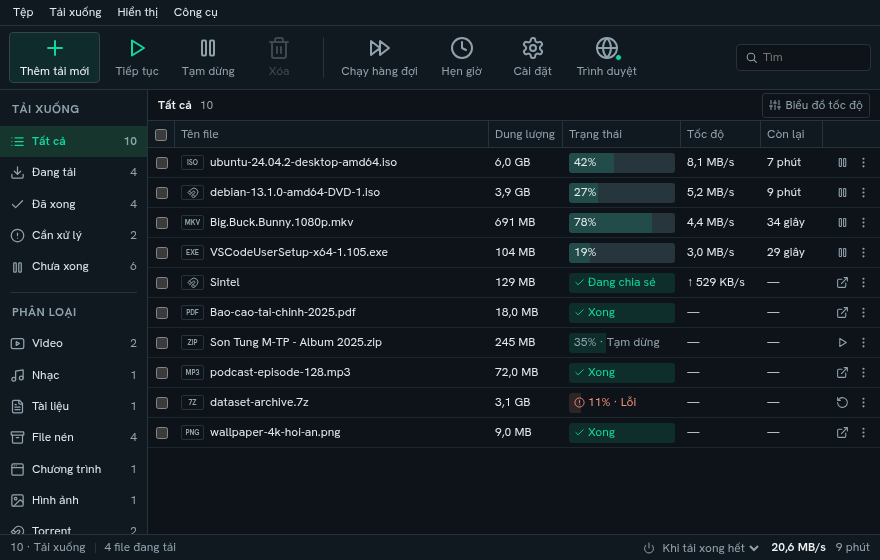

<h1 align="center">Supo Download Manager</h1>

Trình quản lý tải xuống miễn phí, mã nguồn mở cho Windows, macOS và Linux. File · video · Torrent · tích hợp trình duyệt

  <a href="https://github.com/10s3r2604/supodownloadmanager/releases/latest"><b>Tải SDM</b></a> ·
  <a href="README.md">English</a> ·
  <a href="#thiết-lập-trình-duyệt">Cài tiện ích</a> ·
  <a href="CHANGELOG.md">Các thay đổi</a> ·
  <a href="docs/ROADMAP.md">Lộ trình</a>

SDM quản lý tải file, video và Torrent trong cùng một ứng dụng. Giao diện gọn,
có tạm dừng/tải tiếp, hàng đợi, hẹn giờ và thông tin chi tiết khi cần.
Không tài khoản, phí thuê bao, giới hạn số máy hay quảng cáo.

## Tải và cài đặt

Lấy bộ cài và ZIP tiện ích tại [bản phát hành ổn định mới nhất](https://github.com/10s3r2604/supodownloadmanager/releases/latest).
**Bản ổn định hiện tại: SDM 0.7.4**, đi kèm tiện ích trình duyệt **0.6.5**.

| Máy của bạn | File cần chọn |
| --- | --- |
| Windows 10 / 11, x64 | `…_x64-setup.exe` (khuyên dùng), hoặc `…_x64_en-US.msi` |
| macOS, Apple Silicon | `…_aarch64.dmg` |
| macOS, Intel | `…_x64.dmg` |
| Ubuntu / Debian / Mint, x64 | `…_amd64.deb` |
| Fedora / openSUSE, x64 | `….x86_64.rpm` |
| Linux, x64 bản portable | `…_amd64.AppImage` |
| Dòng lệnh | `sdm-cli-…` đúng hệ điều hành |

Bản phát hành có `SHA256SUMS` và chữ ký gói cập nhật. SDM xác minh chữ ký trước
khi cài bản cập nhật Windows. Chữ ký này là cơ chế riêng với chứng thư nhà phát
hành Windows và notarization của macOS. Xem [chi tiết cập nhật](docs/AUTO_UPDATES.md).

### Cập nhật bản đang cài

Với **SDM Windows 0.7.0 trở lên**, vào **Cài đặt → Cập nhật → Kiểm tra ngay**,
rồi chọn **Cài và khởi động lại** sau khi các lượt tải và chia sẻ dừng.
Bản Windows cũ hơn cần cài bộ mới thủ công một lần. Linux/macOS dùng bộ cài
thông thường; chưa bật cài cập nhật tự động trên hai hệ điều hành này.

Sau khi cập nhật SDM, làm mới tiện ích đã cài bằng
**Trình duyệt → tick các browser đang dùng → Thiết lập đã chọn**, rồi tải lại
những tab video đang mở. Tiện ích cũ vẫn hoạt động trong lúc bạn hoàn tất thiết lập.

## Thiết lập trình duyệt

1. Mở SDM. Lần đầu, ứng dụng tự phát hiện trình duyệt đã cài; tick những trình duyệt bạn dùng.
2. Bấm **Thiết lập đã chọn**. Trên Windows, SDM thử nạp tiện ích qua các điều khiển
   thông thường của browser. Đã kiểm tra nạp tự động trên Chrome; nếu browser
   yêu cầu xác nhận, làm theo các bước còn lại được hiển thị.
3. Chờ **Đã kết nối**, rồi thử tải file hoặc rê chuột lên video và bấm
   nút **logo Supo + Download**.

Mở lại phần này bằng nút **Trình duyệt** bất cứ lúc nào. Tiện ích tự kết nối với
SDM 0.7.4, hiện trạng thái và nút **Thử lại / Mở SDM** khi cần. Không phải nhập
port để kết nối; mục chẩn đoán nằm trong phần nâng cao.

Hỗ trợ Chrome, Edge, Cốc Cốc, Brave, Opera, Vivaldi và Firefox. Chưa có listing
trên các kho tiện ích. Dùng tiện ích đi kèm SDM hoặc ZIP ở bản phát hành public.
Xem [hướng dẫn và xử lý lỗi](docs/BROWSER_EXTENSION.md#tiếng-việt) để cài từ ZIP
hoặc dùng Firefox; tiện ích tạm thời của Firefox cần nạp lại sau khi khởi động browser.

## Chức năng và lựa chọn

| Chức năng | Bạn có thể chọn |
| --- | --- |
| Tải file | Tối đa 32 kết nối, tạm dừng/tải tiếp, thử lại, giới hạn tốc độ và proxy. Kiểm tra thông tin file trên server trước khi dùng dữ liệu tải dở. |
| Bắt link browser | Cửa sổ riêng 480 × 320 có tên file, dung lượng, khả năng tải tiếp, nơi lưu và **Tải ngay / Để sau / Hủy**. |
| Video | Chất lượng, định dạng và dung lượng ước tính ngay trên trang; nhận đúng video đã chọn trong feed X. Ghép hình/âm thanh bằng ffmpeg khi cần. |
| Torrent | Link magnet, file `.torrent`, chọn tệp, tải tiếp và giới hạn chia sẻ. |
| Hàng đợi | Nhiều hàng đợi, lịch tải, URL đánh số và chọn link trên trang. |
| File tạm | Thư mục riêng của SDM, đổi được trong **Cài đặt → Chung → Thư mục tạm**. Hoàn tất/xóa lượt tải sẽ dọn dữ liệu làm việc; lượt tạm dừng hoặc lỗi giữ dữ liệu để tải tiếp. Đổi thư mục áp dụng cho lượt tải mới. |
| Giao diện | Gọn, nền tối mặc định; có nền sáng/theo hệ thống và Neon. Biểu đồ tốc độ, kết nối và chi tiết Torrent mở khi cần. |
| Khởi động cùng Windows | Tùy chọn, mặc định tắt; mở trong khay hệ thống khi đăng nhập. |
| Cập nhật Windows | Bản ổn định đã qua kiểm tra, tải nền và cài sau khi công việc dừng; có nút kiểm tra ngay. |

Cửa sổ chính mặc định **880 × 560**, điều chỉnh theo vùng màn hình và DPI.
Nhãn và thao tác vẫn đọc được khi thu nhỏ. Ảnh giao diện dùng dữ liệu demo.

## Quyền riêng tư và giấy phép

Lịch sử tải và cài đặt được lưu trên máy. Tiện ích chuyển URL, cookie và trang
nguồn của lượt tải cho SDM trên cùng máy. SDM liên hệ website đã chọn, tracker/peer
Torrent và nơi cung cấp cập nhật theo [chính sách quyền riêng tư](docs/PRIVACY.md).
Peer Torrent có thể thấy địa chỉ IP khi bạn chia sẻ dữ liệu.

SDM dùng giấy phép [GPL-3.0-or-later](LICENSE). Chỉ tải những gì bạn có quyền tải.
Các công cụ đi kèm giữ giấy phép riêng; xem [danh sách](README.md#privacy-and-license).
Windows có sẵn ffmpeg; trên macOS/Linux, cài ffmpeg bằng package manager để ghép
và chuyển định dạng media. SDM là dự án độc lập.

## Đóng góp

Có thể báo lỗi và đề xuất bằng tiếng Việt hoặc tiếng Anh.
[Hướng dẫn phát triển](CONTRIBUTING.md),
[báo lỗi](https://github.com/10s3r2604/supodownloadmanager/issues/new/choose),
[lộ trình](docs/ROADMAP.md) và
[nguyên tắc sản phẩm](docs/PRODUCT_GUIDELINES.md) nằm trong repo.
