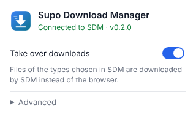
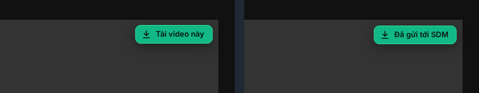

# Browser extension

The SDM extension hands downloads from your browser over to the SDM desktop
app. It works in Chrome, Edge, Cốc Cốc, Brave, Opera, Vivaldi, Chromium and
Firefox.



## What it does

- **Takes over downloads.** When the browser starts downloading a file of a
  type chosen in SDM (Settings → Browser & clipboard), the extension cancels
  the browser download and sends the link to SDM, together with the page's
  cookies, the referer and the browser's user agent. Downloads that need a
  login therefore work in SDM too.
- **Puts a "Download this video" button on videos.** Hover any video that is
  at least 200 × 112 pixels and the button appears in its top right corner
  (also in full screen). A click sends the page to SDM, which finds the video
  with yt-dlp and asks for the quality. The button can be turned off in the
  popup.

  

- **Adds "Download link with SDM"** to the right-click menu of links, images
  and audio, and **"Download the video on this page with SDM"** to the menu of
  videos and pages. Sites such as YouTube replace the video's own menu, so
  right-click next to the player there.
- **Falls back gracefully.** When SDM is not running, the browser downloads as
  usual. When SDM refuses a link, the extension gives it back to the browser.

The popup shows whether SDM is running and lets you turn capturing and the
video button off, set a minimum file size and change the port.

## Installing

### The easy way

Open SDM, click **Browsers**, choose your browser and click **Install
extension**. SDM opens the browser's extension page and shows the steps.

Browsers do not allow other programs to install extensions silently, so the
last click always happens in the browser. Once the extension is published in
the Chrome Web Store and on addons.mozilla.org, that click is simply "Add to
browser". Until then it is installed from a folder:

### Chrome, Edge, Cốc Cốc, Brave, Opera, Vivaldi

1. In SDM, click **Browsers → Install extension** next to your browser. SDM
   copies the extension to its data folder and opens the extension page
   (`chrome://extensions`, `edge://extensions`, ...).
2. Turn on **Developer mode**.
3. Click **Load unpacked** and choose the folder SDM shows (or drag the folder
   onto the page).

### Firefox

1. In SDM, click **Browsers → Install extension** next to Firefox. Firefox
   opens `about:debugging`.
2. Click **Load Temporary Add-on…** and choose `manifest.json` in the folder
   SDM shows.

Firefox removes temporary add-ons when it restarts. A permanent version will be
available on addons.mozilla.org.

## How the extension talks to SDM

SDM runs a small HTTP server on `127.0.0.1:17360` (configurable). It only
accepts requests that:

- carry the `X-SDM-Client` header, which a web page could only send after a
  CORS preflight that SDM never approves, and
- come from a browser extension (`chrome-extension://`, `moz-extension://`)
  when an `Origin` is present.

So websites cannot start downloads in SDM. By default SDM also shows the
"Add download" dialog for every download from the browser, so nothing is
downloaded without your confirmation.

| Endpoint             | Purpose                                                  |
| -------------------- | -------------------------------------------------------- |
| `GET /api/ping`      | Is SDM running? Returns its version and settings          |
| `POST /api/download` | Hand over a download: `url`, `referrer`, `cookies`, `userAgent`, `fileName`, `fileSize` |
| `POST /api/media`    | Hand over a page with a video: `pageUrl`, `title`, `mediaUrl`, `cookies` (list), `userAgent`, `referrer` |

The cookies of a video page go only to the SDM app on your computer. SDM
writes them into the download's private work folder for yt-dlp and deletes
them as soon as the video is complete.

## Building

```sh
node extension/build.mjs
```

This writes `extension/dist/chromium` and `extension/dist/firefox`. The
desktop app bundles both and the release workflow publishes them as zip files.

## Publishing (maintainers)

1. **Chrome Web Store**: register a developer account (one-time fee), upload
   `sdm-extension-chromium-<version>.zip` from the release. Edge, Cốc Cốc,
   Brave, Opera and Vivaldi can all install from the Chrome Web Store.
2. **Firefox**: upload `sdm-extension-firefox-<version>.zip` to
   [addons.mozilla.org](https://addons.mozilla.org/developers/) (free).
3. Put the store links into `CHROME_WEB_STORE_URL` and `FIREFOX_ADDONS_URL` in
   `apps/desktop/src-tauri/src/browsers.rs`. From then on the **Install
   extension** button opens the store page instead of the folder steps.
