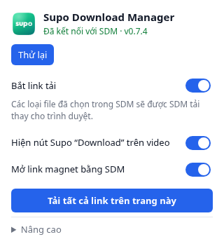

# Browser extension

The SDM extension hands downloads from your browser over to the SDM desktop
app. It works in Chrome, Edge, Cốc Cốc, Brave, Opera, Vivaldi, Chromium and
Firefox.

The current packages require Chromium-based browsers version **116 or newer**,
or Firefox **140 or newer**, as declared in their manifests.

The current stable release is **SDM 0.7.4**, with extension **0.6.5**. It connects
automatically and retains compatibility with SDM 0.6.1 or newer. On first-run
setup, select the detected browsers and choose **Set up selected**. Windows
attempts to load the unpacked extension using the selected browser's normal
controls. If the browser requires confirmation, SDM shows the remaining steps.
Automatic loading is validated in Chrome. Other browsers may need the guided
steps when their controls require confirmation or are unavailable. The list shows
**Connected** only after the extension talks to SDM.

Existing installations can open **Browsers** for the same selection and setup.
Choosing **Later** dismisses the first-run prompt; it can always be reopened
from the toolbar. Updating an unpacked extension still requires browser reload
and reloading video tabs. SDM preserves a separately installed newer version.


## What it does

- **Takes over downloads.** When the browser starts downloading a file of a
  type chosen in SDM (Settings → Browser & clipboard), the extension cancels
  the browser download and sends the link to SDM, together with the page's
  cookies, the referer and the browser's user agent. Downloads that need a
  login therefore work in SDM too.
  It also checks when Chrome determines or updates the file name, so GitHub
  release assets served through an opaque redirect as `application/octet-stream`
  are captured as EXE/ZIP. SDM receives the original request URL and its cookies.
  Multiple download events create only one SDM handover; a refused handover
  returns the link to the browser.
  With browser-download confirmation enabled (the default), captured files
  open a small separate SDM window over the browser. Review the filename,
  size and save folder, then choose **Download now**, **Download later** or
  **Cancel**. The main SDM window stays in the background. Each pending link
  has its own confirmation, and closing one does not quit the app.
- **Puts a compact Supo logo + "Download" button on videos.** Hover any video that is
  at least 200 × 112 pixels and the button appears in its top right corner
  (also in full screen). Click to choose quality, format and estimated file
  size right on the page. SDM discovers formats in the background; a download
  starts only after you choose an option. On X feeds the extension finds the
  hovered video's post and retains its clip index. Errors and **Try again**
  stay in the page menu, and the X video context menu opens that same picker.
  The button can be turned off in the popup. SDM must be running.

  

- **Opens magnet links in SDM.** A click on a magnet link shows SDM's torrent
  dialog instead of asking which program to use (when SDM is running; can be
  turned off in the popup). `.torrent` files the browser downloads go to SDM too.
- **Adds "Download link with SDM"** to the right-click menu of links (also
  magnet links), images and audio, and **"Download the video on this page with SDM"** to the menu of
  videos and pages. Sites such as YouTube replace the video's own menu, so
  right-click next to the player there.
- **Falls back gracefully.** When SDM is not running, the browser downloads as
  usual. When SDM refuses a link, the extension gives it back to the browser.

The popup shows connection status, **Try again** and, when available, **Open SDM**.
You can turn capturing and the video button off or set a minimum file size.
Port settings are reserved for older versions under **Advanced → Connection diagnostics**.

## Installing

### The easy way

Open SDM, click **Browsers**, tick the browsers you use and choose **Set up
selected**. On Windows, SDM attempts loading through each browser's normal
controls. Chrome automatic loading is verified. Follow the remaining guided
steps if your browser requires confirmation or its controls are unavailable.

Wait for **Connected**. Setup does not alter browser profiles or enterprise
policies. Store listings are not published yet; SDM includes the extension and
the [latest release](https://github.com/10s3r2604/supodownloadmanager/releases/latest)
also has public ZIPs. You do not need a GitHub Actions artifact to install it.

### Chrome, Edge, Cốc Cốc, Brave, Opera, Vivaldi

If SDM shows manual steps:

1. In SDM, use **Browsers → Set up selected** (or **Install extension** next to
   one browser). SDM copies the extension to its data folder and opens the extension page
   (`chrome://extensions`, `edge://extensions`, ...).
2. Turn on **Developer mode**.
3. Click **Load unpacked** and choose the folder SDM shows (or drag the folder
   onto the page).

For an existing installation, update SDM first, then use **Set up selected** to
refresh the bundled extension. If manual reload is requested, click **Reload**
on its card, then reload open video tabs. An app update alone does not reload an
already installed unpacked extension. If using a new folder, remove the old SDM
extension first so only one is active.

To install from a release ZIP, choose `sdm-extension-chromium-v0.7.4.zip`, extract
it into a permanent folder, then **Load unpacked** from the folder containing
`manifest.json`. Keep that folder in place. The `store-chromium` build is for
store submission and disables YouTube video controls; use the regular Chromium
build for the app's full video integration.

### Firefox

1. In SDM, click **Browsers → Install extension** next to Firefox. Firefox
   opens `about:debugging`.
2. Click **Load Temporary Add-on…** and choose `manifest.json` in the folder
   SDM shows.

Firefox removes temporary add-ons when it restarts. Permanent store installation
is planned; no addons.mozilla.org listing is published yet.

For ZIP installation, extract `sdm-extension-firefox-v0.7.4.zip` and select its
`manifest.json`. Keep SDM running while connecting a newly loaded extension.

## Troubleshooting

- **Not connected:** keep SDM running and click **Try again** in the popup.
  Use **Open SDM** when offered. If integration is disabled, enable it in
  **Settings → Browser & clipboard**.
- **Old extension after an app update:** use **Browsers → Set up selected**,
  complete any reload step, and reload video tabs.
- **A file stays in Chrome/Edge:** check that capture is on, its file type is
  selected in SDM and its size meets the minimum. An unavailable or refused
  handover leaves the browser able to download normally.
- **X feed video:** use the hovered clip's Supo button to choose quality and
  estimated size. If discovery fails, use **Try again** in the page menu.
- **ZIP downloads:** use public release assets. Actions artifacts may require
  GitHub sign-in and expire.

Advanced diagnostics are for older clients and connection troubleshooting.
Current versions do not need matching port settings.

## How the extension talks to SDM

This section is for developers and advanced troubleshooting.

Current versions use the browser's Native Messaging API. SDM registers its host
for the current user. The host connects to a private named pipe on Windows or a
user-owned Unix socket on macOS/Linux, and forwards only the supported download,
quality-selection and status requests. The extension needs no TCP port setting.
Windows installers register the host even when SDM is not launched immediately;
app startup also refreshes registration. Uninstallation removes the Windows host
registration, and updates preserve it. Existing unpacked IDs and preferences stay
unchanged; a ZIP loaded from another location registers its ID through the
compatibility handshake automatically while SDM is running.

Older extensions and desktop builds retain the HTTP bridge on `127.0.0.1:17360`
(configurable only in connection diagnostics). It only accepts requests that:

- carry the `X-SDM-Client` header, which a web page could only send after a
  CORS preflight that SDM never approves, and
- come from a browser extension (`chrome-extension://`, `moz-extension://`)
  when an `Origin` is present.

So websites cannot start downloads in SDM. By default SDM also shows the
"Add download" dialog for every download from the browser, so nothing is
downloaded without your confirmation.

| Endpoint             | Purpose                                                  |
| -------------------- | -------------------------------------------------------- |
| `GET /api/ping`      | Is SDM running? Returns its version and settings          |
| `POST /api/download` | Hand over a download: `url`, `referrer`, `cookies`, `userAgent`, `fileName`, `fileSize` |
| `POST /api/media`    | Hand over a page with a video: `pageUrl`, `title`, `mediaUrl`, `cookies` (list), `userAgent`, `referrer` |
| `POST /api/media/probe` | Read qualities in the background for the page menu |
| `POST /api/media/add` | Start the quality explicitly selected in the page menu |

The cookies of a video page go only to the SDM app on your computer. SDM
writes them into the download's private work folder for yt-dlp and deletes
them as soon as the video is complete.

## Building

```sh
node extension/build.mjs
```

This writes `extension/dist/chromium`, `extension/dist/chromium-store` and
`extension/dist/firefox`. The desktop app bundles the first and the last; the
store build is the one for the Chrome Web Store and Edge Add-ons (see
[STORE.md](STORE.md)). The release workflow publishes all three as zip files.

## Publishing (maintainers)

See [STORE.md](STORE.md) for the store packages, listing texts, privacy answers, images
and the publishing workflow.

## Tiếng Việt

Gói hiện tại yêu cầu Chrome/Chromium 116 trở lên hoặc Firefox 140 trở lên.

1. Cài hoặc cập nhật SDM từ [bản ổn định mới nhất](https://github.com/10s3r2604/supodownloadmanager/releases/latest).
2. Mở **Trình duyệt**, tick browser đang dùng rồi bấm **Thiết lập đã chọn**.
   Đã kiểm tra nạp tự động trên Chrome Windows; browser khác có thể cần xác nhận
   theo các bước SDM hiển thị.
3. Chờ **Đã kết nối**, rồi tải thử file hoặc bấm **logo Supo + Download** trên video.
   Chất lượng và dung lượng ước tính được chọn ngay trên trang, kể cả video trong feed X.

Không phải nhập port. Nếu chưa kết nối, mở SDM và bấm **Thử lại** trong popup;
dùng **Mở SDM** khi được hiển thị. Sau khi cập nhật app, cần làm mới tiện ích và
tải lại tab video.



Nếu cài từ ZIP public: với Chrome/Edge dùng `sdm-extension-chromium-v0.7.4.zip`,
giải nén vào thư mục cố định, bật **Developer mode**, bấm **Load unpacked** rồi
chọn thư mục chứa `manifest.json`. Không dùng bản `store-chromium` nếu cần đầy
đủ nút video. Với Firefox, dùng ZIP `firefox`, vào `about:debugging`, bấm
**Load Temporary Add-on…** và chọn `manifest.json`; cần nạp lại sau khi khởi động
Firefox. Chưa có listing chính thức trên các kho tiện ích.
