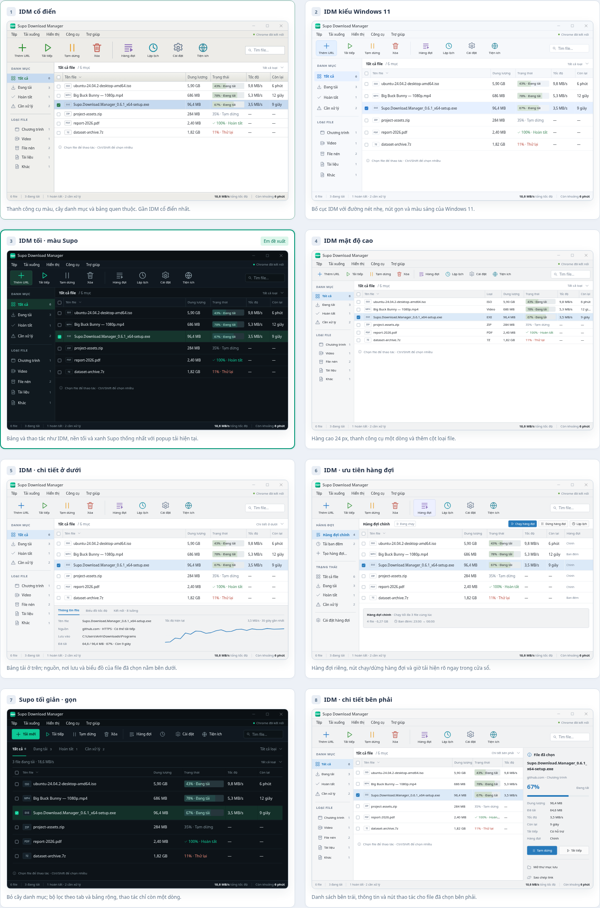
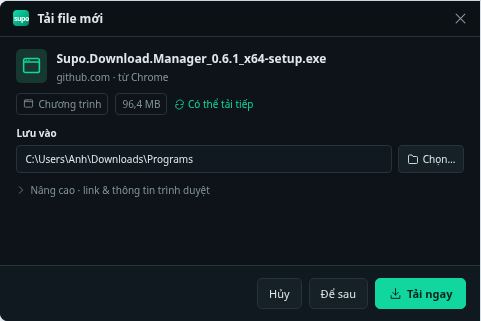

# 8 phương án giao diện SDM cỡ IDM

Anh đã chọn **mẫu 3 — IDM tối, màu Supo**. Bố cục này được triển khai trong SDM 0.7.0; tám bản mẫu bên dưới được giữ lại để tham khảo quá trình chọn thiết kế.

[Mở bản HTML để chọn mẫu và xem popup](idm-ui-review.html). Bản HTML chạy độc lập, không cần mạng hoặc cài thư viện; nếu xem trên GitHub, tải file rồi mở bằng trình duyệt.

| Mẫu | Hướng thiết kế | Điểm nên cân nhắc |
| --- | --- | --- |
| [1 — IDM cổ điển](previews/01-idm-classic.png) | Menu, nút lớn, cây loại file, bảng nhiều cột; gần cách bố trí IDM cổ điển nhất. | Giao diện sáng, thiên về công cụ Windows truyền thống. |
| [2 — IDM Windows 11](previews/02-idm-windows11.png) | Giữ bố cục IDM, dùng khoảng cách và nút kiểu Windows hiện đại. | Cân bằng giữa thông tin và độ dễ đọc; phù hợp giao diện sáng. |
| [3 — IDM tối, màu Supo](previews/03-idm-dark.png) | Bảng và thanh công cụ như IDM, nền tối và màu xanh cùng popup hiện tại. | **Đã chọn và triển khai trong 0.7.0.** |
| [4 — IDM mật độ cao](previews/04-idm-dense.png) | Thanh công cụ nhỏ, hàng thấp, dành phần lớn diện tích cho danh sách. | Xem nhiều lượt tải cùng lúc; chữ và nút nhỏ hơn các mẫu khác. |
| [5 — IDM có chi tiết phía dưới](previews/05-idm-bottom-details.png) | Bảng tải ở trên, thông tin và biểu đồ của file đang chọn ở dưới. | Theo dõi một file thuận tiện; danh sách có ít hàng hiện cùng lúc hơn. |
| [6 — IDM ưu tiên hàng chờ](previews/06-idm-queues.png) | Hàng chờ, lịch tải và thao tác bắt đầu/dừng hàng chờ được đưa ra trước. | Phù hợp tải nhiều file theo lịch; bố cục chú trọng hàng chờ. |
| [7 — Supo tối giản, thu gọn](previews/07-supo-compact.png) | Giữ cách dùng danh sách đơn giản hiện tại, bỏ tiêu đề lớn, giảm khoảng trống. | Dễ làm quen với SDM hiện tại; ít giống IDM hơn các mẫu bảng. |
| [8 — IDM có chi tiết bên phải](previews/08-idm-right-details.png) | Bảng ở trái, thông tin và thao tác của file đang chọn ở phải. | Chi tiết luôn dễ thấy; vùng tên file hẹp hơn và cần cho phép ẩn khung bên phải. |

Kích thước đề xuất chung: cửa sổ chính **880 × 560**, popup bắt link **480 × 320** ở mức hiển thị 100%. Đây là kích thước thiết kế để đạt cảm giác gọn kiểu IDM, không khẳng định là kích thước mặc định chính thức của IDM. Khi áp dụng, cửa sổ phải giới hạn theo vùng làm việc của màn hình và mức DPI; cửa sổ chính dự kiến cho thu nhỏ tới khoảng 660 × 420.

Popup vẫn hiển thị tên file chỉnh được, nguồn, dung lượng, khả năng tải tiếp, nơi lưu và ba nút **Hủy / Để sau / Tải ngay**. Mục **Chi tiết** mở URL đầy đủ và thông tin bổ sung; phần nội dung cuộn khi cần, các nút cuối luôn hiện. Popup hoàn tất giữ cùng chiều ngang với popup bắt link.

Các phương án vẫn phải giữ bộ lọc loại/trạng thái file, chọn nhiều lượt tải, hàng chờ và lịch tải, trình duyệt, cài đặt, torrent và lỗi chi tiết. Hình thức đặt các lựa chọn thay đổi theo mẫu; không bỏ chức năng để đạt kích thước nhỏ.

Hành vi đã chốt cho phần triển khai tiếp theo:

- **Khởi động cùng Windows:** tùy chọn, mặc định tắt. Khi bật, mở ở khay hệ thống khi đăng nhập, không tự giành focus hoặc mở cửa sổ chính.
- **Cập nhật tự động:** nhận **bản phát hành ổn định đã qua kiểm tra**, theo lựa chọn của anh. Commit được kiểm tra và đưa vào bản phát hành có phiên bản mới; ứng dụng nhận bản phát hành đó. Kiểm tra/tải nền, cài khi các tác vụ đã dừng an toàn hoặc khi thoát; có nút kiểm tra ngay và tùy chọn tắt.
- Bản 0.6.1 hiện chưa có updater. Bản đầu tiên bổ sung tính năng này cần được cài thủ công một lần. Chữ ký bảo vệ gói cập nhật là cơ chế riêng; ký EXE để hiện nhà phát hành trên Windows vẫn là phần việc riêng.

Chi tiết hoạt động và cấu hình phát hành: [Khởi động và cập nhật ổn định](../AUTO_UPDATES.md). Bộ cài từ CI dùng để review; cập nhật công khai cần bản phát hành ổn định đã ký.
